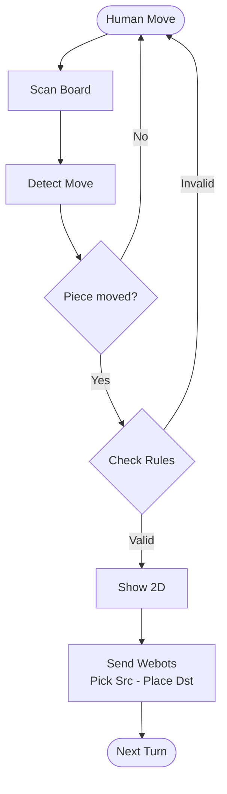

# 🔍 Deep Dive: Detecting Objects — How the Pieces Move

> 🇹🇭 [ภาษาไทย (Thai version)](DEEP_DIVE_DETECTION_TH.md) · Back to the main [README](README.md)

This document explains **how a physical move on the real board becomes a pick-and-place command for the Webots robot arm**, step by step. It follows the order of the presentation:

`Human Move → Scan Board → Detect Move → Check Rules → Show 2D → Send to Webots`

Every statement below was checked against the source code (`chess_single_player.py`, `chess_live_board.py`, `moves.c`, `engine_api.c`, `Robot jec/controllers/ur10e_chess/ur10e_chess.py`).

---

## 0. Overview

### 0.1 Flowchart



### 0.2 One-line summary of each stage

| # | Stage | What happens | Output | Code |
| :-: | :--- | :--- | :--- | :--- |
| 1 | **Human Move** | Player moves a White piece on the real board, presses `Space`/`Enter` | trigger | `WAITING_HUMAN` state |
| 2 | **Scan Board** | Camera frame → HSV sticker colours → perspective transform → 8×8 grid, 16 frames | 16 "instant boards" | `scan_board_frame()` |
| 3 | **Detect Move** | Compare the scan with the digital array to find *source* and *destination* | `"e2e4"` | differential tracking |
| 4 | **Check Rules** | C chess engine decides if the move is legal | legal / illegal | `engine_is_legal_move()` |
| 5 | **Show 2D** | Animate the piece, update the array, save memory | updated `board_2d` | `animate_move()` |
| 6 | **Send Webots** | JSON command (`src`, `dst`, `elim`…) over TCP + queue file; wait until arm is parked | arm moves | `emit_webots_instruction()` |

### 0.3 Two programs, one detector

| | `chess_live_board.py` (**Live Board**) | `chess_single_player.py` (**Single Player**) |
| :--- | :--- | :--- |
| Purpose | Mirror *every* physical move (both colours) on the 2D board | Human (White) vs. C-engine AI (Black) |
| Who is tracked | White **and** Black pieces | White pieces only (Black is moved by the AI) |
| Detection | 16 frames → `hit_counts` → differential tracking | Same, but only White pieces can be a *source* |
| Rule check | Only a pawn-distance filter (no chess engine) | Pawn filter **+** full C engine legality check |
| Extra safety | Fallback pairing when only one side is found | Field-integrity check before the AI moves |
| Webots | — | Sends commands, waits for each arm |

---

## 1. Human Move — *Why HSV stickers instead of YOLO?*

### 1.1 The design decision

| Question | Answer in this project |
| :--- | :--- |
| What does the camera see? | A **top-down** view of the board |
| Why is YOLO a poor fit for the *pieces*? | From above, every piece is a round blob. Knight / Bishop / Pawn silhouettes are very hard to tell apart, and tall pieces hide short ones at an angle. |
| What would YOLO need? | A labelled dataset (typically hundreds to thousands of photos per piece type, in all lighting conditions) and a training run — **again** whenever the piece set, board or lighting changes. |
| What do we use instead? | A **coloured sticker on top of each piece** (the colour encodes the piece *type*) + the **brightness of the piece body** (encodes the *team*). Pure classical vision, no training. |
| Where is YOLO used then? | `best.pt` is a custom model that only detects the **board** (`detect_board.py`). Piece identification is entirely HSV. |

> **Result:** we trade "learn the shape of a piece" (hard) for "read one colour" (easy), and we save the time of photographing and labelling thousands of images for one goal.

### 1.2 How information is "injected" without retraining

The knowledge lives in **one small table** (`TAGS` in `chess_single_player.py`), not in neural-network weights:

```python
TAGS = {
  'Queen':  {'lower': [  5,110,110], 'upper': [ 22,255,255], 'code': 'Q'},
  'Pawn':   {'lower': [ 22,110,110], 'upper': [ 36,255,255], 'code': 'P'},
  'Knight': {'lower': [ 33, 35, 35], 'upper': [ 88,255,255], 'code': 'N'},
  'Bishop': {'lower': [ 88, 70, 70], 'upper': [120,255,255], 'code': 'B'},
  'King':   {'lower': [120, 30, 60], 'upper': [148,255,255], 'code': 'K'},
  'Rook':   {'lower': [148, 80, 80], 'upper': [178,255,255], 'code': 'R'},
}
```

| Sticker colour | Hue range (OpenCV 0-180) | Piece | Code letter |
| :--- | :--- | :--- | :-: |
| Orange | 5 – 22 | Queen | `Q` |
| Yellow | 22 – 36 | Pawn | `P` |
| Green | 33 – 88 | Knight | `N` |
| Blue | 88 – 120 | Bishop | `B` |
| Violet | 120 – 148 | King | `K` |
| Magenta | 148 – 178 | Rook | `R` |

**Each job has exactly one owner** (separation of duties):

| Information needed | Who provides it | How |
| :--- | :--- | :--- |
| *Where* is the piece? | Perspective transform | sticker centre `(u,v)` → square `(row,col)` |
| *What type* is the piece? | Sticker **hue** (HSV) | `cv2.inRange(hsv, lower, upper)` |
| *Which team* is the piece? | Body **brightness** under the sticker | mean gray `> 155` → `W`, else `B` |
| *Is the move legal?* | C chess engine | `engine_is_legal_move()` |

To change something (a new sticker colour, different lighting) you edit **one row** of `TAGS` or `BRIGHT_THRESH` — no dataset, no labelling, no training.

Result of one detection is a two-letter code: `team + type`, e.g. `WP` = White Pawn, `BK` = Black King.

---

## 2. Scan Board — corners, (0,0) / (800,800) and never losing orientation

### 2.1 Goal

Turn a slanted camera picture into a perfect **800 × 800** top-down board so every square is exactly **100 × 100 px**.

```
(0,0)=a8 ┌────┬────┬────┬────┬────┬────┬────┬────┐ (800,0)=h8
         │a8  │b8  │c8  │d8  │e8  │f8  │g8  │h8  │  row 0  = rank 8
         ├────┼────┼────┼────┼────┼────┼────┼────┤
         │ …  │    │    │    │    │    │    │    │
         ├────┼────┼────┼────┼────┼────┼────┼────┤
         │a1  │b1  │c1  │d1  │e1  │f1  │g1  │h1  │  row 7  = rank 1
(0,800)=a1 └────┴────┴────┴────┴────┴────┴────┴────┘ (800,800)=h1
           col 0 = file a                col 7 = file h
```

> The **two opposite corners** `a8 ↔ h1` are always `(0,0)` and `(800,800)`. The other diagonal `h8 ↔ a1` is `(800,0)` and `(0,800)`.

### 2.2 Initial-state scan, step by step

| Step | What the system does | Why it matters |
| :-: | :--- | :--- |
| 1 | Open the camera (iPhone via Continuity Camera, 1920×1080), apply digital zoom | stable, full-size frame |
| 2 | Load the 4 board corners from `board_corners.json` (or press `c` and click them) | tells the program where the playing area is |
| 3 | Sort the 4 points by **screen position** into `top-left, top-right, bottom-right, bottom-left` | pure geometry: smaller `y` = top, smaller `x` = left |
| 4 | **Auto-detect orientation** (`auto_detect_orientation_from_board`): compare mean brightness of the four board edges (top/bottom/left/right). The **brighter** side is where the White pieces stand | decides *which physical corner is a8* |
| 5 | Assign corners → `a8, h8, h1, a1` according to the orientation (table 2.3) | fixes `(0,0)` = a8 and `(800,800)` = h1 |
| 6 | `M = cv2.getPerspectiveTransform(src, dst)` | 3×3 homography matrix |
| 7 | For every sticker centre `(u,v)`: `cv2.perspectiveTransform` → `(x,y)` | pixel → flat board |
| 8 | `col = int(x/100)`, `row = int(y/100)` | square index (`row 0` = rank 8, `col 0` = file a) |

Math of step 6-8:

```
[x']   [m00 m01 m02] [u]
[y'] = [m10 m11 m12] [v]      x = x'/w ,  y = y'/w
[w ]   [m20 m21 m22] [1]      col = ⌊x/100⌋ ,  row = ⌊y/100⌋
```

### 2.3 How the system knows which corner is (0,0)

`order_corners_90deg()` always sorts the clicked corners as TL/TR/BR/BL first, then the **orientation** (0–3) chooses which physical corner plays the role of `a8`:

| Orientation | Meaning | a8 | h8 | h1 | a1 | `(0,0)` ← | `(800,800)` ← |
| :-: | :--- | :-: | :-: | :-: | :-: | :-: | :-: |
| 0 | White at bottom | TL | TR | BR | BL | TL | BR |
| 1 | White at left | TR | BR | BL | TL | TR | BL |
| 2 | White at top | BL | BR | TR | TL | BL | TR |
| 3 | White at right *(default)* | TL | BL | BR | TR | TL | BR |

Whatever the table says, the pair `{a8, h1}` is always a **diagonal**, so the system only needs to decide *which end of that diagonal is a8*. That decision comes from the **piece colours** (bright = White), not from the user's camera angle.

### 2.4 Why this prevents losing direction

When the board was rotated during testing, the map flipped: the real world played **White** while the 2D board moved **Black** (mirrored sides). The fix is that orientation is re-detected from the *real pieces* at start-up (and on reset with `1`/`r`), and can be corrected manually with `f` (flip 180°), `o` (rotate 90°) and `u` (auto). After this, rotating the physical board no longer swaps colours.

> ⚠️ **Note about red anchor dots.** `detect_red_anchors()` exists in the code (it finds two red circular markers by HSV red range + circularity). In `chess_live_board.py` the markers are **highlighted on screen**; in `chess_single_player.py` the function is defined but **not called**. The `(0,0)` / `(800,800)` assignment currently comes from the corner sort + brightness-based orientation described above, **not** from the red dots. Present red dots as a visual aid, or enable them for orientation as future work.

### 2.5 Scan of the pieces

For each of the 6 colours in `TAGS`: HSV mask → `MORPH_OPEN` + `MORPH_DILATE` (noise removal) → contours (`area ≥ MIN_AREA`) → centre → square → team. The result is one **instant board**: an 8×8 array of codes.

---

## 3. Detect Move — comparing the array with the real world

### 3.1 The memory array

The digital twin is a 2D list `board_2d[row][col]` (8×8). It starts as the standard set-up and is the *memory* of what we believe is on the board:

```python
board_2d = [
 ['BR','BN','BB','BQ','BK','BB','BN','BR'],  # row 0 = rank 8
 ['BP','BP','BP','BP','BP','BP','BP','BP'],  # row 1 = rank 7
 [None]*8, [None]*8, [None]*8, [None]*8,      # rows 2-5
 ['WP','WP','WP','WP','WP','WP','WP','WP'],  # row 6 = rank 2
 ['WR','WN','WB','WQ','WK','WB','WN','WR'],  # row 7 = rank 1
]
# square name  ->  index:   f"{'abcdefgh'[col]}{8-row}"     e2 = board_2d[6][4]
```

### 3.2 Algorithm

| Step | Logic | Threshold |
| :-: | :--- | :--- |
| 1 | Capture **16 frames** (≈ 0.5 s) after the human presses `Space`/`Enter` | `scan_passes ≥ 16` |
| 2 | For every square count how many frames saw a sticker → `hit_counts[r][c]`; majority vote of the code → `detected_types[r][c]` | `Counter.most_common` |
| 3 | **Emptied** candidates: squares where memory has a **White** piece but `hit_counts < 2` | piece was lifted |
| 4 | **Occupied** candidates: (a) empty in memory and `hit_counts ≥ 2`; (b) enemy piece in memory and `hit_counts ≥ 6` (capture) | piece arrived |
| 5 | Pair every *emptied* with every *occupied* → candidate moves. Pawns must move ≤ 2 rows / ≤ 1 col (capture: exactly 1 diagonal) | pre-filter |
| 6 | Score each pair, keep the **best one only** (prevents "double moves") | see below |
| 7 | Build the move string `src+dst`, e.g. `"e2e4"` | |

Score = `10` + `200` (destination was empty) + `100` (same piece type) + `50` (same team) − `15 × (|Δrow| + |Δcol|)` — so the closest, most natural pair wins.

### 3.3 Worked example: White plays e2 → e4

Memory (before) vs. scan (after), only the changed squares shown:

| Square | Array index | Memory (before) | `hit_counts` / 16 | Verdict |
| :-: | :-: | :-: | :-: | :--- |
| e2 | `[6][4]` | `WP` | 0 | **emptied** → source |
| e4 | `[4][4]` | `None` | 15 (`WP`) | **occupied** → destination |
| every other square | — | unchanged | consistent | ignored |

Only one pair exists → `candidate_moves = [{src:(6,4), dst:(4,4), score: 10+200+100+50−30 = 330}]` → move = `"e2e4"`.

If **no** candidate is found (nothing moved) the program prints *"no movement found"*, keeps the array unchanged and goes back to waiting for the human.

---

## 4. Check Rules — legal move? (including "no crossing")

The move string is sent to the C engine: `engine_is_legal_move("e2e4")`. The engine builds **all legal moves** for the side to move and returns `true` only if the requested move is in that list.

```
generate_legal_moves = generate_pseudo_moves
                       → for each: make_move → is_in_check(own king)? → undo_move
                       → keep only if the own king is NOT in check
```

### 4.1 Conditions per piece

| Piece | Allowed | Blocked / forbidden |
| :--- | :--- | :--- |
| **Pawn** | 1 step forward if the square is **empty**; 2 steps from the start rank only if **both** squares are empty; capture 1 diagonal **only if an enemy is there**; reaching the last rank promotes (to Queen) | cannot move forward onto a piece, cannot capture straight, cannot move backward |
| **Knight** | 8 L-jumps (±2,±1) | destination holding an own piece. *Jumping over pieces is allowed.* |
| **Bishop** | any distance diagonally | **stops at the first piece** — cannot cross it; may capture it only if it is an enemy |
| **Rook** | any distance on a rank/file | **stops at the first piece** — cannot cross it |
| **Queen** | Rook + Bishop rays | **stops at the first piece** |
| **King** | 1 step to an empty/enemy square; castling if rights remain, squares between are empty and none of the 3 king squares is attacked | cannot castle through or out of check |
| **Every piece** | — | **a move that leaves your own king in check is illegal** (pins, moving into check) |

*(Not implemented in this engine: en passant. Promotion is automatic to a Queen.)*

### 4.2 Easy examples

Start position, White to move:

| Move | Result | Why |
| :--- | :-: | :--- |
| `e2e4` | ✅ | pawn, first move, `e3` and `e4` empty |
| `e2e5` | ❌ | pawn may move at most 2 squares |
| `a1a5` | ❌ | rook ray is **blocked** by the pawn on `a2` — no crossing |
| `c1e3` | ❌ | bishop ray is blocked by the pawn on `d2` |
| `b1c3` | ✅ | knight jumps over pieces, `c3` is empty |
| `d1d3` | ❌ | queen blocked by `d2` |
| `e1e2` | ❌ | destination holds an own piece |

Pseudo-code of a sliding piece (rook/bishop/queen) — this is the "no crossing" rule:

```
for each direction (dr, dc):
    r, c = start
    loop:
        r += dr ; c += dc
        if outside board:            stop
        if square is empty:          add move ; continue
        if square has ENEMY piece:   add move (capture) ; stop
        if square has OWN piece:     stop            # cannot cross, cannot land
```

### 4.3 What happens after the check

| Result | System reaction |
| :--- | :--- |
| ❌ **Illegal** | Red glow on the source/destination squares (10 s), status "ILLEGAL MOVE", the AI/robot is **blocked** (`Enter` refused) until the piece is put back and the move is redone |
| ✅ **Legal** | continue to *Show 2D* and *Send Webots* |
| ⚪ **No movement** | array unchanged, wait for the next try |

Before the AI moves, `verify_field_environment()` scans 8 more frames to confirm the physical board still matches the array (nothing fell over or is missing); otherwise the AI refuses to move and highlights the mismatched squares.

---

## 5. Show 2D

| Action | Detail |
| :--- | :--- |
| Animate | `animate_move()` slides the piece icon from `src` to `dst` |
| Update memory | `board_2d[dst] = piece ; board_2d[src] = None` (only the moved square changes — the other 62 stay) |
| Castling | king move `e1→g1` (or `e1→c1`) automatically also moves the rook (`h1→f1` or `a1→d1`) |
| Persist | `save_mini_memory_state()` → `mini_memory_board.json` (board matrix, turn, last move, piece count) |

---

## 6. Send to Webots — from array index to joint angles

### 6.1 What is sent

```json
{ "action": "MOVE", "player": "White", "src": "e2", "dst": "e4",
  "elim": null, "is_castling": false, "turn": 1, "command_id": 1 }
```

| Field | Meaning |
| :--- | :--- |
| `src` | square to **pick** from |
| `dst` | square to **place** on |
| `elim` | square of a captured piece (robot removes it first to the graveyard), else `null` |
| `player` | selects which arm moves (`White` → UR10e(1), TCP `10002`; `Black` → UR10e, TCP `10001`) |

Delivery: **TCP socket** (instant) **+ dedicated queue file** (`webots_queue_w.json` / `webots_queue_b.json`, written atomically and *consumed once*). The controller de-duplicates by `(session, command_id)` and a move signature, so each command runs **exactly once** (the `session` id changes on every launch of the Python program, so the first command of a new game is never mistaken for an old one).

### 6.2 Step-by-step calculation (example e2 → e4)

**Step 1 — array index → square name**
`board_2d[6][4]` → col 4 = `e`, rank = 8 − 6 = 2 → `"e2"`; `board_2d[4][4]` → `"e4"`.

**Step 2 — square name → world X,Y** (Webots, metres). Two calibration points define the whole board: `a1 = (-0.41, 0.38)`, `h8 = (-1.15, -0.38)`.

```
col = ord(file) - ord('a')        row = rank - 1
x = A1_X + (col/7) · (H8_X − A1_X)
y = A1_Y + (row/7) · (H8_Y − A1_Y)
```

| Square | col | row | x | y |
| :-: | :-: | :-: | :-: | :-: |
| a1 | 0 | 0 | −0.4100 | 0.3800 |
| **e2** | 4 | 1 | −0.41 + (4/7)(−0.74) = **−0.8329** | 0.38 + (1/7)(−0.76) = **0.2714** |
| **e4** | 4 | 3 | **−0.8329** | 0.38 + (3/7)(−0.76) = **0.0543** |
| h8 | 7 | 7 | −1.1500 | −0.3800 |

**Step 3 — heights (Z).** Touch height depends on the piece (pawn `0.145 m`, knight `0.173`, king `0.178`, others `0.165`); cruise `Z_TRAVEL = 0.50 m`, clearance `Z_CLEAR = 0.30 m`. A pawn on `e2` → `Z = 0.145`.

**Step 4 — waypoints** (all above the source or destination):

| # | Waypoint | (x, y, z) for e2→e4 |
| :-: | :--- | :--- |
| 1 | `src_travel` | (−0.833, 0.271, 0.50) |
| 2 | `src_clear` | (−0.833, 0.271, 0.30) |
| 3 | `src_touch` | (−0.833, 0.271, 0.145) |
| 4 | `dst_travel` | (−0.833, 0.054, 0.50) |
| 5 | `dst_clear` | (−0.833, 0.054, 0.30) |
| 6 | `dst_touch` | (−0.833, 0.054, 0.145) |

**Step 5 — inverse kinematics.** Each waypoint is converted into the base frame of the arm (`ROT_MATRIX.T · (target − base)`) and solved with **ikpy** with the gripper pointing straight down → 6 joint angles.

**Step 6 — state machine** (each stage waits for the computed flight time):

```
IDLE → SWING_TO_BOARD → PAUSE → [ELIM … if capture] → APPROACH_CRUISE → APPROACH_CLEAR
     → TOUCH_DESCEND → SUCTION (vacuum ON) → LIFT_CLEAR → LIFT_CRUISE → TRANSFER
     → STAGE_CLEAR → TOUCH_PLACE → RELEASE (vacuum OFF) → RETRACT → RETURN (park) → IDLE
```

### 6.3 One arm at a time

After sending the White command, Single Player waits (`wait_for_webots_robot`) until the arm reports `busy:false, stage:IDLE` in `webots_status_w.json`. Only then does the AI compute and send the Black move, and again waits for `webots_status_b.json`. The arms also check each other's status files, so they **never move simultaneously**.

---

## 7. Chess Live Board — overview and deep dive

`chess_live_board.py` is the **pure tracking** version: it mirrors both players' moves on the 2D board and has no AI and no Webots link.

| Aspect | Detail |
| :--- | :--- |
| Mode `1` | assume the 32 pieces are in the standard set-up, auto-detect orientation |
| Mode `0` | live-scan the whole board |
| Trigger | `Space` after a physical move |
| Capture | 16 frames, `hit_counts` / majority vote, same differential tracking as §3 |
| Pair filter | pawn distance rule + score (same formula) |
| Fallback 1 | exactly one *emptied* but no *occupied* → pick the empty square with the most hits |
| Fallback 2 | exactly one *occupied* but no *emptied* → pick the same piece type with the fewest hits |
| One move only | only the best-scored candidate is applied → no double moves |
| Castling | king moving two files also moves the rook |
| Turn | `current_turn` toggles `W ⇄ B` (`t` toggles manually) |
| No change | "No change detected, digital board preserved" |

Useful keys: `c` calibrate 4 corners · `u` auto-orient · `f` flip 180° · `o` rotate 90° · `z/x` zoom · `w/a/s/d` move frame · `+/-` resize · `r` reset · `q` quit.

The file also contains helper functions for stricter filtering (`evaluate_quad_consensus` 3-of-4 quorum, `apply_demographic_filter`, `enforce_chess_rules` piece-count limits K1 Q1 R2 B2 N2 P8, `is_plausible_chess_move`). They are defined but are **not wired into the main loop** in the current version; the main loop relies on the 16-frame differential tracking above.

---

## 8. Summary for the presentation

1. **Human Move** — HSV sticker colour (type) + body brightness (team); no YOLO training needed for pieces.
2. **Scan Board** — 4 corners + brightness-based orientation → `a8 = (0,0)`, `h1 = (800,800)` → perspective transform → 100 px squares; orientation can't be lost.
3. **Detect Move** — 8×8 array vs. 16-frame scan → *emptied* + *occupied* → best pair → `"e2e4"`.
4. **Check Rules** — C engine: legal-move generation, rays stop at pieces, king must not be in check.
5. **Show 2D** — animate, update the array, save memory.
6. **Send Webots** — `src`/`dst`/`elim` JSON → square → world XY/Z → IK → pick-and-place, one arm at a time.
