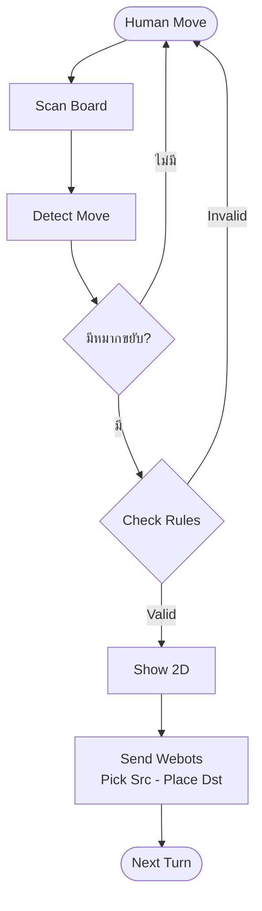

# 🔍 เจาะลึกการตรวจจับวัตถุ — หมากเดินอย่างไร (Deep Dive)

> 🇬🇧 [English version](DEEP_DIVE_DETECTION.md) · กลับไปที่ [README หลัก](README_TH.md)

เอกสารนี้อธิบาย **ขั้นตอนทั้งหมดตั้งแต่ผู้เล่นขยับหมากบนกระดานจริง จนกลายเป็นคำสั่งหยิบ–วางให้แขนกล Webots** เรียงตามลำดับที่ใช้พรีเซนต์:

`Human Move → Scan Board → Detect Move → Check Rules → Show 2D → Send Webots`

ทุกข้อความตรวจสอบกับโค้ดจริงแล้ว (`chess_single_player.py`, `chess_live_board.py`, `moves.c`, `engine_api.c`, `Robot jec/controllers/ur10e_chess/ur10e_chess.py`)

---

## 0. ภาพรวม (Overview)

### 0.1 Flowchart



### 0.2 สรุปแต่ละขั้นตอนบรรทัดเดียว

| # | ขั้นตอน | ทำอะไร | ผลลัพธ์ | โค้ด |
| :-: | :--- | :--- | :--- | :--- |
| 1 | **Human Move** | ผู้เล่นขยับหมากขาวบนกระดานจริง แล้วกด `Space`/`Enter` | ตัวกระตุ้น | สถานะ `WAITING_HUMAN` |
| 2 | **Scan Board** | ภาพกล้อง → สีสติกเกอร์ HSV → perspective transform → ตาราง 8×8 สแกน 16 เฟรม | "กระดานชั่วขณะ" 16 ใบ | `scan_board_frame()` |
| 3 | **Detect Move** | เทียบผลสแกนกับ array ดิจิทัล หา *ช่องต้นทาง* และ *ช่องปลายทาง* | `"e2e4"` | differential tracking |
| 4 | **Check Rules** | C chess engine ตัดสินว่าเดินถูกกติกาหรือไม่ | ถูก / ผิด | `engine_is_legal_move()` |
| 5 | **Show 2D** | อนิเมตหมาก อัปเดต array บันทึกความจำ | `board_2d` ใหม่ | `animate_move()` |
| 6 | **Send Webots** | ส่ง JSON (`src`, `dst`, `elim`…) ทาง TCP + ไฟล์คิว แล้วรอแขนกลจอดพัก | แขนกลขยับ | `emit_webots_instruction()` |

### 0.3 สองโปรแกรม ใช้ตัวตรวจจับเดียวกัน

| | `chess_live_board.py` (**Live Board**) | `chess_single_player.py` (**Single Player**) |
| :--- | :--- | :--- |
| จุดประสงค์ | สะท้อน *ทุกตา* บนกระดานจริง (ทั้งสองสี) ลงหน้า 2D | คน (ขาว) vs AI จาก C engine (ดำ) |
| หมากที่ติดตาม | ขาว **และ** ดำ | เฉพาะขาว (ดำ AI เป็นคนเดิน) |
| การตรวจจับ | 16 เฟรม → `hit_counts` → differential tracking | เหมือนกัน แต่ *ต้นทาง* ต้องเป็นหมากขาวเท่านั้น |
| ตรวจกติกา | แค่กรองระยะเดินของเบี้ย (ไม่มี chess engine) | กรองเบี้ย **+** ตรวจ legal move เต็มรูปแบบด้วย C engine |
| ความปลอดภัยเพิ่ม | Fallback เมื่อเจอแค่ฝั่งเดียว | ตรวจสภาพสนามจริงก่อน AI เดิน |
| Webots | — | ส่งคำสั่ง และรอแขนกลทีละตัว |

---

## 1. Human Move — *ทำไม HSV สติกเกอร์ ดีกว่า YOLO ในโปรเจกต์นี้*

### 1.1 เหตุผลการออกแบบ

| คำถาม | คำตอบในโปรเจกต์นี้ |
| :--- | :--- |
| กล้องมองเห็นอะไร | ภาพ **มุมบน (top view)** ของกระดาน |
| ทำไม YOLO ไม่เหมาะกับ *ตัวหมาก* | มองจากด้านบน หมากทุกตัวเป็นวงกลมคล้ายกันหมด ม้า/บิชอป/เบี้ยแยกยากมาก และหมากสูงบังหมากเตี้ยเมื่อกล้องเอียง |
| YOLO ต้องการอะไร | ชุดภาพที่ติดป้ายแล้ว (โดยทั่วไปหลักร้อยถึงหลักพันรูปต่อชนิดหมาก ในแสงหลายแบบ) และต้อง **เทรนใหม่** ทุกครั้งที่เปลี่ยนชุดหมาก กระดาน หรือแสง |
| ใช้อะไรแทน | **สติกเกอร์สีบนหัวหมากแต่ละตัว** (สี = *ชนิด* หมาก) + **ความสว่างของลำตัวหมาก** (= *ฝั่ง*) ใช้ computer vision แบบดั้งเดิม ไม่ต้องเทรน |
| แล้ว YOLO ใช้ตรงไหน | `best.pt` เป็นโมเดลที่เทรนเองสำหรับตรวจจับ **กระดาน** เท่านั้น (`detect_board.py`) ส่วนการแยกชนิดหมากใช้ HSV ทั้งหมด |

> **ผลลัพธ์:** เปลี่ยนจาก "เรียนรู้รูปทรงหมาก" (ยาก) เป็น "อ่านสีเดียว" (ง่าย) และประหยัดเวลาไม่ต้องถ่าย/ติดป้ายภาพนับพันรูปเพื่อเป้าหมายเดียวกัน

### 1.2 วิธี "ยัดข้อมูล" โดยไม่ต้องเทรนใหม่

ความรู้ทั้งหมดอยู่ใน **ตารางเล็กๆ ตารางเดียว** (`TAGS` ใน `chess_single_player.py`) ไม่ใช่ weight ของ neural network:

```python
TAGS = {
  'Queen':  {'lower': [  5,110,110], 'upper': [ 22,255,255], 'code': 'Q'},
  'Pawn':   {'lower': [ 22,110,110], 'upper': [ 36,255,255], 'code': 'P'},
  'Knight': {'lower': [ 33, 35, 35], 'upper': [ 88,255,255], 'code': 'N'},
  'Bishop': {'lower': [ 88, 70, 70], 'upper': [120,255,255], 'code': 'B'},
  'King':   {'lower': [120, 30, 60], 'upper': [148,255,255], 'code': 'K'},
  'Rook':   {'lower': [148, 80, 80], 'upper': [178,255,255], 'code': 'R'},
}
```

| สีสติกเกอร์ | ช่วง Hue (OpenCV 0-180) | หมาก | ตัวอักษร |
| :--- | :--- | :--- | :-: |
| ส้ม | 5 – 22 | Queen (ควีน) | `Q` |
| เหลือง | 22 – 36 | Pawn (เบี้ย) | `P` |
| เขียว | 33 – 88 | Knight (ม้า) | `N` |
| ฟ้า | 88 – 120 | Bishop (บิชอป) | `B` |
| ม่วง | 120 – 148 | King (ขุน) | `K` |
| ชมพูม่วง | 148 – 178 | Rook (เรือ) | `R` |

**แบ่งหน้าที่ชัดเจน — แต่ละข้อมูลมีเจ้าของเดียว:**

| ข้อมูลที่ต้องรู้ | ใครให้ | ทำอย่างไร |
| :--- | :--- | :--- |
| หมากอยู่ *ที่ไหน* | Perspective transform | จุดกลางสติกเกอร์ `(u,v)` → ช่อง `(row,col)` |
| หมาก *ชนิดอะไร* | **สี Hue** ของสติกเกอร์ (HSV) | `cv2.inRange(hsv, lower, upper)` |
| หมาก *ฝั่งไหน* | **ความสว่าง** ลำตัวใต้สติกเกอร์ | ค่าเฉลี่ย gray `> 155` → `W` ไม่งั้น `B` |
| เดินถูกกติกา *หรือไม่* | C chess engine | `engine_is_legal_move()` |

ถ้าจะเปลี่ยนอะไร (สีสติกเกอร์ใหม่ แสงต่างไป) แก้ **แค่แถวเดียว** ใน `TAGS` หรือ `BRIGHT_THRESH` — ไม่ต้องมี dataset ไม่ต้อง label ไม่ต้องเทรน

ผลการตรวจจับหนึ่งครั้งคือรหัส 2 ตัวอักษร `ฝั่ง + ชนิด` เช่น `WP` = เบี้ยขาว, `BK` = ขุนดำ

---

## 2. Scan Board — มุมกระดาน, (0,0) / (800,800) และการไม่หลงทิศ

### 2.1 เป้าหมาย

แปลงภาพกระดานที่เอียงจากกล้อง ให้เป็นกระดานมุมบนสมบูรณ์ **800 × 800** เพื่อให้ทุกช่องกว้างพอดี **100 × 100 px**

```
(0,0)=a8 ┌────┬────┬────┬────┬────┬────┬────┬────┐ (800,0)=h8
         │a8  │b8  │c8  │d8  │e8  │f8  │g8  │h8  │  row 0  = แรงค์ 8
         ├────┼────┼────┼────┼────┼────┼────┼────┤
         │ …  │    │    │    │    │    │    │    │
         ├────┼────┼────┼────┼────┼────┼────┼────┤
         │a1  │b1  │c1  │d1  │e1  │f1  │g1  │h1  │  row 7  = แรงค์ 1
(0,800)=a1 └────┴────┴────┴────┴────┴────┴────┴────┘ (800,800)=h1
           col 0 = ไฟล์ a                col 7 = ไฟล์ h
```

> **มุมตรงข้ามทแยง** `a8 ↔ h1` คือ `(0,0)` และ `(800,800)` เสมอ ส่วนอีกทแยง `h8 ↔ a1` คือ `(800,0)` และ `(0,800)`

### 2.2 ขั้นตอนการสแกนใน Initial State

| ขั้น | ระบบทำอะไร | สำคัญเพราะ |
| :-: | :--- | :--- |
| 1 | เปิดกล้อง (iPhone ผ่าน Continuity Camera 1920×1080) และซูมดิจิทัล | ภาพเต็มและนิ่ง |
| 2 | โหลด 4 มุมกระดานจาก `board_corners.json` (หรือกด `c` แล้วคลิกมุมเอง) | บอกว่าพื้นที่เล่นอยู่ตรงไหน |
| 3 | เรียง 4 จุดตาม **ตำแหน่งบนจอ** เป็น `ซ้ายบน, ขวาบน, ขวาล่าง, ซ้ายล่าง` | เรขาคณิตล้วนๆ: y น้อย = บน, x น้อย = ซ้าย |
| 4 | **ตรวจทิศอัตโนมัติ** (`auto_detect_orientation_from_board`) เทียบความสว่างเฉลี่ยของขอบกระดานทั้ง 4 ด้าน ด้านที่ **สว่างกว่า** คือฝั่งหมากขาว | ตัดสินว่า *มุมไหนคือ a8* |
| 5 | กำหนดมุม → `a8, h8, h1, a1` ตามทิศ (ตาราง 2.3) | ได้ `(0,0)` = a8 และ `(800,800)` = h1 |
| 6 | `M = cv2.getPerspectiveTransform(src, dst)` | เมทริกซ์ homography 3×3 |
| 7 | ทุกจุดกลางสติกเกอร์ `(u,v)`: `cv2.perspectiveTransform` → `(x,y)` | พิกเซลกล้อง → กระดานแบนราบ |
| 8 | `col = int(x/100)`, `row = int(y/100)` | ดัชนีช่อง (`row 0` = แรงค์ 8, `col 0` = ไฟล์ a) |

คณิตศาสตร์ขั้น 6-8:

```
[x']   [m00 m01 m02] [u]
[y'] = [m10 m11 m12] [v]      x = x'/w ,  y = y'/w
[w ]   [m20 m21 m22] [1]      col = ⌊x/100⌋ ,  row = ⌊y/100⌋
```

### 2.3 ระบบรู้ได้อย่างไรว่ามุมไหนคือ (0,0)

`order_corners_90deg()` เรียงมุมเป็น TL/TR/BR/BL ก่อนเสมอ แล้ว **orientation** (0–3) เป็นตัวเลือกว่ามุมจริงมุมไหนทำหน้าที่เป็น `a8`:

| Orientation | ความหมาย | a8 | h8 | h1 | a1 | `(0,0)` ← | `(800,800)` ← |
| :-: | :--- | :-: | :-: | :-: | :-: | :-: | :-: |
| 0 | ขาวอยู่ล่าง | TL | TR | BR | BL | TL | BR |
| 1 | ขาวอยู่ซ้าย | TR | BR | BL | TL | TR | BL |
| 2 | ขาวอยู่บน | BL | BR | TR | TL | BL | TR |
| 3 | ขาวอยู่ขวา *(ค่าเริ่มต้น)* | TL | BL | BR | TR | TL | BR |

ไม่ว่าตารางจะเป็นอย่างไร คู่ `{a8, h1}` เป็น **มุมทแยงตรงข้ามกัน** เสมอ ระบบจึงต้องตัดสินแค่ว่า *ปลายไหนของเส้นทแยงนั้นคือ a8* ซึ่งคำตอบมาจาก **สีของหมากจริง** (สว่าง = ขาว) ไม่ใช่จากมุมกล้องของผู้ใช้

### 2.4 ทำไมจึงไม่หลงทิศ

ตอนทดลองหมุนกระดาน แผนที่เคยกลับด้าน: โลกจริงเดิน **ขาว** แต่ 2D เดิน **ดำ** (สลับฝั่ง) วิธีแก้คือตรวจทิศใหม่จาก *หมากจริง* ตอนเริ่มโปรแกรม (และตอนรีเซ็ตด้วย `1`/`r`) และแก้เองได้ด้วย `f` (กลับ 180°), `o` (หมุน 90°), `u` (อัตโนมัติ) หลังจากนั้นหมุนกระดานจริงก็ไม่ทำให้สีสลับอีก

> ⚠️ **หมายเหตุเรื่องจุดแดง** ในโค้ดมีฟังก์ชัน `detect_red_anchors()` (หาจุดวงกลมสีแดง 2 จุดด้วยช่วงสีแดง HSV + ความกลม) ใน `chess_live_board.py` จุดแดง **ถูกไฮไลต์บนจอ** ส่วนใน `chess_single_player.py` ฟังก์ชันนี้ถูกประกาศไว้แต่ **ไม่ได้ถูกเรียกใช้** ตอนนี้การกำหนด `(0,0)` / `(800,800)` มาจากการเรียงมุม + ทิศจากความสว่างตามที่อธิบายข้างต้น **ไม่ได้มาจากจุดแดง** เวลาพรีเซนต์ควรพูดว่าจุดแดงเป็นตัวช่วยมองเห็น หรือเป็นแผนต่อยอดถ้าจะใช้กำหนดทิศ

### 2.5 การสแกนหมาก

สำหรับสีทั้ง 6 ใน `TAGS`: HSV mask → `MORPH_OPEN` + `MORPH_DILATE` (ลบสัญญาณรบกวน) → contour (`area ≥ MIN_AREA`) → จุดกลาง → ช่อง → ฝั่ง ผลคือ **กระดานชั่วขณะ** หนึ่งใบ: array 8×8 ของรหัสหมาก

---

## 3. Detect Move — เทียบ array กับโลกจริง

### 3.1 Array ความจำ

Digital twin คือ list 2 มิติ `board_2d[row][col]` (8×8) เริ่มต้นเป็นการจัดหมากมาตรฐาน และเป็น *ความจำ* ว่าเราเชื่อว่าบนกระดานมีอะไร:

```python
board_2d = [
 ['BR','BN','BB','BQ','BK','BB','BN','BR'],  # row 0 = แรงค์ 8
 ['BP','BP','BP','BP','BP','BP','BP','BP'],  # row 1 = แรงค์ 7
 [None]*8, [None]*8, [None]*8, [None]*8,      # row 2-5
 ['WP','WP','WP','WP','WP','WP','WP','WP'],  # row 6 = แรงค์ 2
 ['WR','WN','WB','WQ','WK','WB','WN','WR'],  # row 7 = แรงค์ 1
]
# ชื่อช่อง -> ดัชนี:   f"{'abcdefgh'[col]}{8-row}"     e2 = board_2d[6][4]
```

### 3.2 อัลกอริทึม

| ขั้น | ตรรกะ | เกณฑ์ |
| :-: | :--- | :--- |
| 1 | เก็บ **16 เฟรม** (≈ 0.5 วินาที) หลังผู้เล่นกด `Space`/`Enter` | `scan_passes ≥ 16` |
| 2 | นับแต่ละช่องว่ากี่เฟรมเห็นสติกเกอร์ → `hit_counts[r][c]` และโหวตเสียงข้างมากของรหัส → `detected_types[r][c]` | `Counter.most_common` |
| 3 | ผู้สมัคร **ว่างลง**: ช่องที่ความจำมีหมาก **ขาว** แต่ `hit_counts < 2` | หมากถูกยกออก |
| 4 | ผู้สมัคร **มีหมากใหม่**: (ก) ช่องว่างในความจำและ `hit_counts ≥ 2` (ข) ช่องที่ความจำมีหมากศัตรูและ `hit_counts ≥ 6` (กินหมาก) | หมากมาถึง |
| 5 | จับคู่ *ว่างลง* กับ *มีหมากใหม่* ทุกคู่ → ท่าที่เป็นไปได้ เบี้ยต้องเดิน ≤ 2 แถว / ≤ 1 คอลัมน์ (กิน: ทแยง 1 ช่องพอดี) | กรองเบื้องต้น |
| 6 | ให้คะแนนทุกคู่ แล้วเลือก **คู่ที่ดีที่สุดเพียงคู่เดียว** (กัน "เดินซ้อน 2 ตา") | ดูสูตรด้านล่าง |
| 7 | สร้างสตริงท่าเดิน `src+dst` เช่น `"e2e4"` | |

คะแนน = `10` + `200` (ปลายทางว่าง) + `100` (ชนิดหมากตรงกัน) + `50` (สีตรงกัน) − `15 × (|Δแถว| + |Δคอลัมน์|)` — คู่ที่ใกล้และเป็นธรรมชาติที่สุดจึงชนะ

### 3.3 ตัวอย่าง: ขาวเดิน e2 → e4

ความจำ (ก่อน) เทียบกับสแกน (หลัง) แสดงเฉพาะช่องที่เปลี่ยน:

| ช่อง | ดัชนี array | ความจำ (ก่อน) | `hit_counts` / 16 | ตัดสิน |
| :-: | :-: | :-: | :-: | :--- |
| e2 | `[6][4]` | `WP` | 0 | **ว่างลง** → ต้นทาง |
| e4 | `[4][4]` | `None` | 15 (`WP`) | **มีหมากใหม่** → ปลายทาง |
| ช่องอื่นทั้งหมด | — | เดิม | สอดคล้อง | ไม่สนใจ |

มีคู่เดียว → `candidate_moves = [{src:(6,4), dst:(4,4), score: 10+200+100+50−30 = 330}]` → ท่าเดิน = `"e2e4"`

ถ้า **ไม่พบ** ผู้สมัครเลย (ไม่มีอะไรขยับ) โปรแกรมจะแจ้ง *"ไม่พบการขยับหมาก"* คง array เดิม และกลับไปรอผู้เล่น

---

## 4. Check Rules — เดินถูกกติกาไหม (รวมถึง "ห้ามข้ามหมาก")

สตริงท่าเดินถูกส่งให้ C engine: `engine_is_legal_move("e2e4")` engine สร้าง **ท่าเดินถูกกฎทั้งหมด** ของฝ่ายที่ถึงตา แล้วคืน `true` เฉพาะเมื่อท่าที่ขอมีอยู่ในลิสต์นั้น

```
generate_legal_moves = generate_pseudo_moves
                       → ทุกท่า: make_move → is_in_check(ขุนตัวเอง)? → undo_move
                       → เก็บเฉพาะท่าที่ขุนตัวเอง "ไม่" ถูกรุก
```

### 4.1 เงื่อนไขของหมากแต่ละชนิด

| หมาก | เดินได้ | ห้าม / ถูกบล็อก |
| :--- | :--- | :--- |
| **Pawn (เบี้ย)** | เดินหน้า 1 ช่องถ้าช่อง **ว่าง**; เดิน 2 ช่องจากแถวเริ่มต้นเฉพาะเมื่อ **ทั้งสองช่อง** ว่าง; กินทแยง 1 ช่อง **เมื่อมีศัตรูอยู่เท่านั้น**; ถึงแถวสุดท้ายเลื่อนขั้นเป็น Queen | เดินหน้าชนหมากไม่ได้ กินตรงๆ ไม่ได้ ถอยหลังไม่ได้ |
| **Knight (ม้า)** | กระโดดรูปตัว L 8 ทิศ (±2,±1) | ปลายทางมีหมากฝั่งตัวเอง — *กระโดดข้ามหมากได้* |
| **Bishop (บิชอป)** | ทแยงกี่ช่องก็ได้ | **หยุดที่หมากตัวแรก** — ข้ามไม่ได้ กินได้เฉพาะศัตรู |
| **Rook (เรือ)** | แนวนอน/แนวตั้งกี่ช่องก็ได้ | **หยุดที่หมากตัวแรก** — ข้ามไม่ได้ |
| **Queen (ควีน)** | รวมเรือ + บิชอป | **หยุดที่หมากตัวแรก** |
| **King (ขุน)** | 1 ช่องไปช่องว่าง/ศัตรู; เข้าป้อมถ้ายังมีสิทธิ์ ช่องระหว่างว่าง และขุนทั้ง 3 ช่องไม่ถูกโจมตี | เข้าป้อมขณะถูกรุก/ผ่านช่องที่ถูกโจมตีไม่ได้ |
| **ทุกตัว** | — | **ท่าที่ทำให้ขุนตัวเองถูกรุกถือว่าผิดกฎ** (หมากถูกปักหลัง, เดินเข้าหาการรุก) |

*(engine นี้ยังไม่รองรับ en passant และการเลื่อนขั้นเป็น Queen อัตโนมัติ)*

### 4.2 ตัวอย่างเข้าใจง่าย

ตำแหน่งเริ่มต้น ขาวเดิน:

| ท่า | ผล | เหตุผล |
| :--- | :-: | :--- |
| `e2e4` | ✅ | เบี้ยเดินครั้งแรก `e3` และ `e4` ว่าง |
| `e2e5` | ❌ | เบี้ยเดินได้ไม่เกิน 2 ช่อง |
| `a1a5` | ❌ | แนวเรือ **ถูกบล็อก** ด้วยเบี้ย `a2` — ห้ามข้าม |
| `c1e3` | ❌ | แนวบิชอปถูกบล็อกด้วยเบี้ย `d2` |
| `b1c3` | ✅ | ม้ากระโดดข้ามหมากได้ `c3` ว่าง |
| `d1d3` | ❌ | ควีนถูก `d2` บล็อก |
| `e1e2` | ❌ | ปลายทางมีหมากฝั่งตัวเอง |

Pseudo-code ของหมากวิ่งไกล (เรือ/บิชอป/ควีน) — นี่คือกฎ "ห้ามข้าม":

```
ทุกทิศทาง (dr, dc):
    r, c = จุดเริ่ม
    วนซ้ำ:
        r += dr ; c += dc
        ถ้าออกนอกกระดาน:           หยุด
        ถ้าช่องว่าง:               เพิ่มท่า ; ไปต่อ
        ถ้ามีหมาก "ศัตรู":          เพิ่มท่า (กิน) ; หยุด
        ถ้ามีหมาก "ตัวเอง":         หยุด            # ข้ามไม่ได้ ลงไม่ได้
```

### 4.3 หลังตรวจกติกา

| ผล | ระบบตอบสนอง |
| :--- | :--- |
| ❌ **ผิดกฎ** | ไฟแดงกระพริบที่ช่องต้นทาง/ปลายทาง (10 วินาที) แจ้ง "ILLEGAL MOVE" และ **บล็อก** AI/หุ่นยนต์ (กด `Enter` ไม่ได้) จนกว่าจะวางหมากกลับและเดินใหม่ |
| ✅ **ถูกกฎ** | ไปต่อที่ *Show 2D* และ *Send Webots* |
| ⚪ **ไม่มีการขยับ** | array คงเดิม รอลองใหม่ |

ก่อน AI เดิน `verify_field_environment()` สแกนเพิ่ม 8 เฟรมเพื่อยืนยันว่ากระดานจริงยังตรงกับ array (ไม่มีหมากล้มหรือหาย) ถ้าไม่ตรง AI จะปฏิเสธการเดินและไฮไลต์ช่องที่ไม่ตรง

---

## 5. Show 2D

| การทำงาน | รายละเอียด |
| :--- | :--- |
| อนิเมต | `animate_move()` เลื่อนไอคอนหมากจาก `src` ไป `dst` |
| อัปเดตความจำ | `board_2d[dst] = หมาก ; board_2d[src] = None` (เปลี่ยนเฉพาะช่องที่ขยับ อีก 62 ช่องคงเดิม) |
| เข้าป้อม | ขุนเดิน `e1→g1` (หรือ `e1→c1`) จะขยับเรือตามอัตโนมัติ (`h1→f1` หรือ `a1→d1`) |
| บันทึก | `save_mini_memory_state()` → `mini_memory_board.json` (เมทริกซ์กระดาน, ตา, ท่าล่าสุด, จำนวนหมาก) |

---

## 6. Send Webots — จากดัชนี array ถึงมุมข้อต่อ

### 6.1 สิ่งที่ส่งไป

```json
{ "action": "MOVE", "player": "White", "src": "e2", "dst": "e4",
  "elim": null, "is_castling": false, "turn": 1, "command_id": 1 }
```

| ฟิลด์ | ความหมาย |
| :--- | :--- |
| `src` | ช่องที่ต้องไป **หยิบ** |
| `dst` | ช่องที่ต้องไป **วาง** |
| `elim` | ช่องของหมากที่ถูกกิน (หุ่นยนต์ต้องหยิบไปทิ้งที่ graveyard ก่อน) ถ้าไม่มีเป็น `null` |
| `player` | เลือกว่าแขนไหนขยับ (`White` → UR10e(1), TCP `10002`; `Black` → UR10e, TCP `10001`) |

ช่องทางส่ง: **TCP socket** (ทันที) **+ ไฟล์คิวแยกฝั่ง** (`webots_queue_w.json` / `webots_queue_b.json` เขียนแบบ atomic และถูก *อ่านแล้วเคลียร์ครั้งเดียว*) controller ตัดคำสั่งซ้ำด้วย `(session, command_id)` และลายเซ็นท่าเดิน ทำให้แต่ละคำสั่งรัน **เพียงครั้งเดียว** (`session` เปลี่ยนทุกครั้งที่เปิดโปรแกรม Python คำสั่งแรกของเกมใหม่จึงไม่ถูกเข้าใจผิดว่าเป็นคำสั่งเก่า)

### 6.2 คำนวณทีละขั้น (ตัวอย่าง e2 → e4)

**ขั้น 1 — ดัชนี array → ชื่อช่อง**
`board_2d[6][4]` → col 4 = `e`, แรงค์ = 8 − 6 = 2 → `"e2"`; `board_2d[4][4]` → `"e4"`

**ขั้น 2 — ชื่อช่อง → พิกัดโลก X,Y** (Webots หน่วยเมตร) จุดสอบเทียบ 2 จุดกำหนดทั้งกระดาน: `a1 = (-0.41, 0.38)`, `h8 = (-1.15, -0.38)`

```
col = ord(ไฟล์) - ord('a')        row = แรงค์ - 1
x = A1_X + (col/7) · (H8_X − A1_X)
y = A1_Y + (row/7) · (H8_Y − A1_Y)
```

| ช่อง | col | row | x | y |
| :-: | :-: | :-: | :-: | :-: |
| a1 | 0 | 0 | −0.4100 | 0.3800 |
| **e2** | 4 | 1 | −0.41 + (4/7)(−0.74) = **−0.8329** | 0.38 + (1/7)(−0.76) = **0.2714** |
| **e4** | 4 | 3 | **−0.8329** | 0.38 + (3/7)(−0.76) = **0.0543** |
| h8 | 7 | 7 | −1.1500 | −0.3800 |

**ขั้น 3 — ความสูง (Z)** ความสูงจุดสัมผัสขึ้นกับหมาก (เบี้ย `0.145 m`, ม้า `0.173`, ขุน `0.178`, ตัวอื่น `0.165`) ความสูงเดินทาง `Z_TRAVEL = 0.50 m` ความสูงเคลียร์ `Z_CLEAR = 0.30 m` เบี้ยที่ `e2` → `Z = 0.145`

**ขั้น 4 — จุดผ่าน (waypoints)** (อยู่เหนือจุดต้นทางหรือปลายทาง):

| # | Waypoint | (x, y, z) สำหรับ e2→e4 |
| :-: | :--- | :--- |
| 1 | `src_travel` | (−0.833, 0.271, 0.50) |
| 2 | `src_clear` | (−0.833, 0.271, 0.30) |
| 3 | `src_touch` | (−0.833, 0.271, 0.145) |
| 4 | `dst_travel` | (−0.833, 0.054, 0.50) |
| 5 | `dst_clear` | (−0.833, 0.054, 0.30) |
| 6 | `dst_touch` | (−0.833, 0.054, 0.145) |

**ขั้น 5 — Inverse kinematics** แปลงแต่ละ waypoint เป็นพิกัดในเฟรมฐานของแขน (`ROT_MATRIX.T · (target − base)`) แล้วแก้ด้วย **ikpy** โดยให้หัวจับชี้ลงตรงๆ → ได้มุมข้อต่อ 6 ค่า

**ขั้น 6 — State machine** (แต่ละสถานะรอเวลาบินที่คำนวณไว้):

```
IDLE → SWING_TO_BOARD → PAUSE → [ELIM … ถ้ากินหมาก] → APPROACH_CRUISE → APPROACH_CLEAR
     → TOUCH_DESCEND → SUCTION (เปิดสูญญากาศ) → LIFT_CLEAR → LIFT_CRUISE → TRANSFER
     → STAGE_CLEAR → TOUCH_PLACE → RELEASE (ปิดสูญญากาศ) → RETRACT → RETURN (จอดพัก) → IDLE
```

### 6.3 ทำงานทีละแขนเท่านั้น

หลังส่งคำสั่งฝั่งขาว Single Player จะรอ (`wait_for_webots_robot`) จนแขนรายงาน `busy:false, stage:IDLE` ใน `webots_status_w.json` แล้ว AI จึงคิดและส่งท่าฝั่งดำ จากนั้นรอ `webots_status_b.json` อีกครั้ง แขนทั้งสองยังตรวจไฟล์สถานะของกันและกัน จึง **ไม่ขยับพร้อมกัน**

---

## 7. Chess Live Board — ภาพรวมและเจาะลึก

`chess_live_board.py` คือเวอร์ชัน **ติดตามอย่างเดียว**: สะท้อนการเดินของทั้งสองฝ่ายลงบอร์ด 2D ไม่มี AI และไม่เชื่อม Webots

| หัวข้อ | รายละเอียด |
| :--- | :--- |
| โหมด `1` | สมมติว่าหมาก 32 ตัวอยู่ตำแหน่งเริ่มต้น และตรวจทิศอัตโนมัติ |
| โหมด `0` | สแกนสดทั้งกระดานจากกล้อง |
| ตัวกระตุ้น | กด `Space` หลังขยับหมากจริง |
| การจับภาพ | 16 เฟรม, `hit_counts` / โหวตเสียงข้างมาก, differential tracking เหมือนข้อ 3 |
| กรองคู่ | กฎระยะเบี้ย + คะแนน (สูตรเดียวกัน) |
| Fallback 1 | เจอ *ว่างลง* ตัวเดียวแต่ไม่เจอ *มีหมากใหม่* → เลือกช่องว่างที่มี hit มากสุด |
| Fallback 2 | เจอ *มีหมากใหม่* ตัวเดียวแต่ไม่เจอ *ว่างลง* → เลือกหมากชนิดเดียวกันที่มี hit น้อยสุด |
| เดินตาเดียว | ใช้เฉพาะผู้สมัครคะแนนสูงสุด → ไม่เกิด double move |
| เข้าป้อม | ขุนเดิน 2 ไฟล์จะขยับเรือตามด้วย |
| ตา | `current_turn` สลับ `W ⇄ B` (กด `t` สลับเอง) |
| ไม่มีการเปลี่ยนแปลง | "No change detected, digital board preserved" |

ปุ่มที่ใช้บ่อย: `c` สอบเทียบ 4 มุม · `u` ตรวจทิศอัตโนมัติ · `f` กลับ 180° · `o` หมุน 90° · `z/x` ซูม · `w/a/s/d` เลื่อนกรอบ · `+/-` ปรับขนาด · `r` รีเซ็ต · `q` ออก

ในไฟล์ยังมีฟังก์ชันกรองเข้มงวด (`evaluate_quad_consensus` โหวต 3 ใน 4, `apply_demographic_filter`, `enforce_chess_rules` จำกัดจำนวนหมาก K1 Q1 R2 B2 N2 P8, `is_plausible_chess_move`) แต่ **ยังไม่ได้ถูกเรียกใช้ใน main loop** ของเวอร์ชันปัจจุบัน main loop ใช้ differential tracking 16 เฟรมตามด้านบน

---

## 8. สรุปสำหรับพรีเซนต์

1. **Human Move** — สีสติกเกอร์ HSV (ชนิด) + ความสว่างลำตัว (ฝั่ง) ไม่ต้องเทรน YOLO สำหรับตัวหมาก
2. **Scan Board** — 4 มุม + ทิศจากความสว่าง → `a8 = (0,0)`, `h1 = (800,800)` → perspective transform → ช่องละ 100 px ไม่หลงทิศ
3. **Detect Move** — array 8×8 เทียบสแกน 16 เฟรม → *ว่างลง* + *มีหมากใหม่* → คู่ที่ดีที่สุด → `"e2e4"`
4. **Check Rules** — C engine: สร้างท่าถูกกฎ, หมากวิ่งไกลหยุดที่หมากตัวแรก, ขุนต้องไม่ถูกรุก
5. **Show 2D** — อนิเมต, อัปเดต array, บันทึกความจำ
6. **Send Webots** — JSON `src`/`dst`/`elim` → ช่อง → พิกัดโลก XY/Z → IK → หยิบ–วาง ทีละแขน
