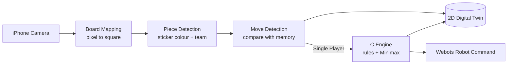
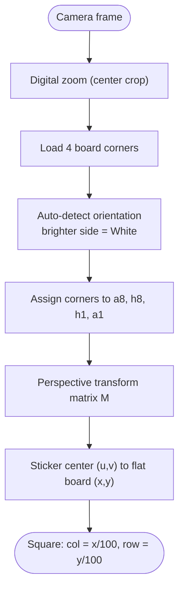
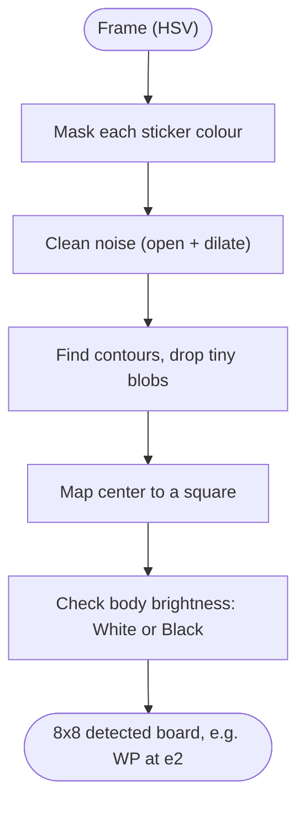
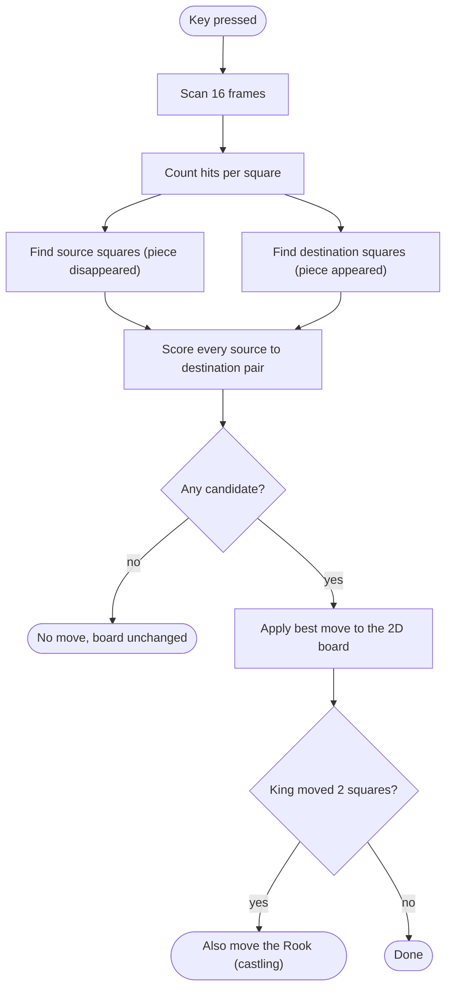
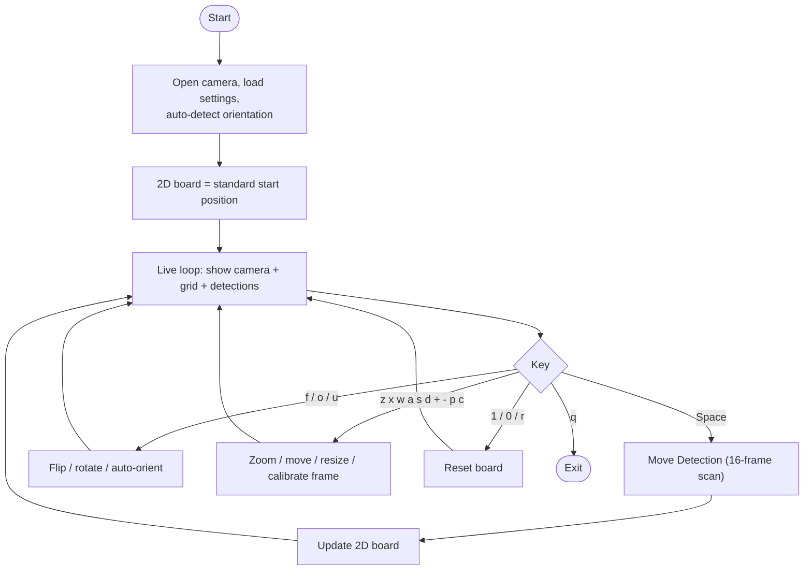
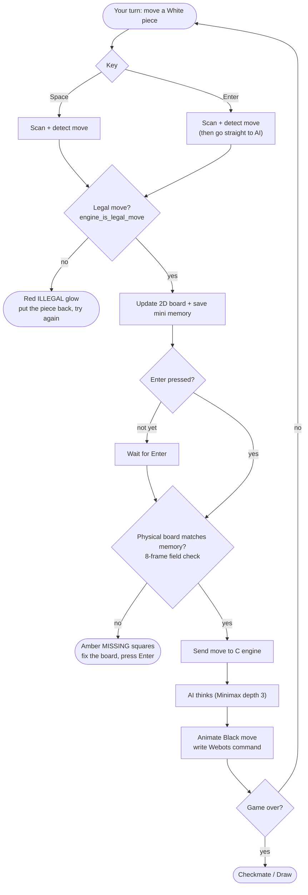
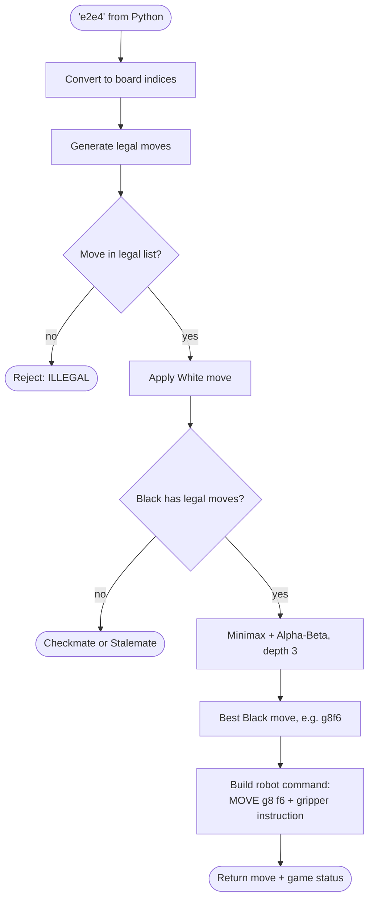

# ♚ Hybrid Physical-to-Digital Twin Chess System

> **Team:** GM ลงเซิฟ — Robotics Course 01306202
> 🇹🇭 [ภาษาไทย (Thai version)](README_TH.md)

## What is this?

A chess system that connects a **real chessboard** to a **digital twin**. A top-down iPhone camera watches the physical board. Each piece has a coloured sticker that identifies its type. The system turns each physical move into a move on a 2D digital board. In Single Player mode, a **C chess AI** answers as Black and sends the move to a Webots robot simulation.

| Program | What it does |
| :--- | :--- |
| `chess_live_board.py` | Tracks every physical move (White and Black) and mirrors it on the 2D board. No AI. |
| `chess_single_player.py` | Human (White, real board) vs. Robot AI (Black, C engine). Checks the human's move against the chess rules, checks that the physical board matches memory, then lets the AI move. |
| `libchess_ai.dylib` (C) | Chess rules + Minimax AI (Alpha-Beta, depth 3), called from Python via `ctypes`. |

---

## Overall Pipeline



---

## 1. Board Mapping (Camera Pixels → Chess Squares)

The 4 board corners (saved, or clicked during calibration) are matched to `a8, h8, h1, a1` based on which side White sits on (auto-detected from brightness). A **perspective transform** then turns the camera view into a flat 800×800 board, where each 100×100 cell is one square.



## 2. Piece Detection

| Sticker colour | Piece |
| :--- | :--- |
| Orange | Queen |
| Yellow | Pawn |
| Green | Knight |
| Blue | Bishop |
| Violet | King |
| Magenta | Rook |

The team is read from the brightness of the piece body just below the sticker (bright = White, dark = Black).



## 3. Move Detection

When the user presses a key, the camera scans **16 frames** and counts how often each square is seen occupied. It then compares this with the digital board kept in memory:

- **Source:** a square that should have a piece but is now almost never seen.
- **Destination:** an empty square that is now occupied (or an enemy square for a capture).
- Each candidate pair gets a score (destination empty, same piece type, same team, short distance). The highest score wins, and **only one move** is applied per scan.
- If the King moves 2 squares (castling), the Rook moves automatically.



---

## 4. `chess_live_board.py` — Live Board Tracker

Mirrors every physical move, for both colours, onto the 2D board.



---

## 5. `chess_single_player.py` — Human vs. Robot AI

You play **White** on the real board. The **AI plays Black**. The AI only moves if:
1. Your move is **legal** (checked by the C engine). Otherwise both squares **glow red** and show "ILLEGAL".
2. The **physical board matches memory**. Otherwise the missing squares **flash amber** and show "MISSING".



---

## 6. C Engine — How the AI Decides

1. Python sends the move as text, e.g. `"e2e4"`, which is converted to board indices.
2. The engine **generates all legal moves**: it makes each candidate move and rejects it if its own King ends up in check. This covers checks, pins and castling.
3. For Black's reply, it runs **Minimax with Alpha-Beta pruning** (depth 3):
   - **Score** = material (P=100, N=320, B=330, R=500, Q=900) + position bonus for pawns and knights. White − Black.
   - White maximises and Black (the AI) minimises. Faster checkmates are preferred.
4. It returns the best move, a robot instruction and a game status (continue / checkmate / stalemate).



**Robot output:** `webots_command.txt` (e.g. `MOVE g8 f6`) and `webots_move.json` (latest move + gripper instruction).

---

## 7. Installation

```bash
pip3 install opencv-python numpy pillow
make            # builds libchess_ai.dylib and robotic_engine
```

Setup tips: place the iPhone **directly above** the board. Make sure the green frame lines up with the board edges and the `WHITE` label sits on the White side.

---

## 8. Usage

### Live Board

```bash
python3 chess_live_board.py 1         # standard start position (recommended)
python3 chess_live_board.py 0         # read the board from the camera
python3 chess_live_board.py 1 flip    # board rotated 180°
python3 chess_live_board.py 1 black   # show the 2D board from Black's side
```

1. Move one piece (either colour) and take your hand away.
2. Press **Space**. The move appears on the 2D board.

### Single Player

```bash
python3 chess_single_player.py 1
```

1. Move a **White** piece and take your hand away.
2. Press **Enter** to end your turn: scan → rule check → board check → AI moves.
   (Press **Space** first if you only want to preview and check your move.)
3. Red glow = illegal move, so put the piece back. Amber = missing pieces, so fix the board and press Enter.
4. Copy the AI's Black move onto the real board, then play your next move.

### Keys

| Key | Live Board | Single Player |
| :---: | :--- | :--- |
| `Space` | Scan & sync move | Scan & check move (no AI) |
| `Enter` | — | End turn → AI moves |
| `1` | Reset to start position | New game |
| `r` | Clear & re-scan | New game |
| `0` | Scan board from camera | — |
| `t` | Toggle turn indicator | — |
| `f` | Flip board 180° | Flip board 180° |
| `F` / `v` | Flip 2D view | — |
| `o` / `u` | Rotate 90° / Auto-orient | Rotate 90° / Auto-orient |
| `z` / `x` | Zoom in / out | Zoom in / out |
| `w a s d` | Move frame | Move frame |
| `+` / `-` | Resize frame | Resize frame |
| `p` | Reset to square frame | Reset to square frame |
| `c` | Click 4 corners to calibrate | Click 4 corners to calibrate |
| `q` | Quit | Quit |
