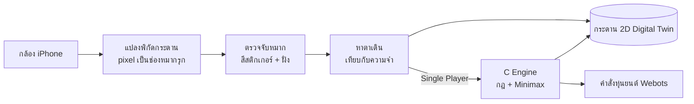
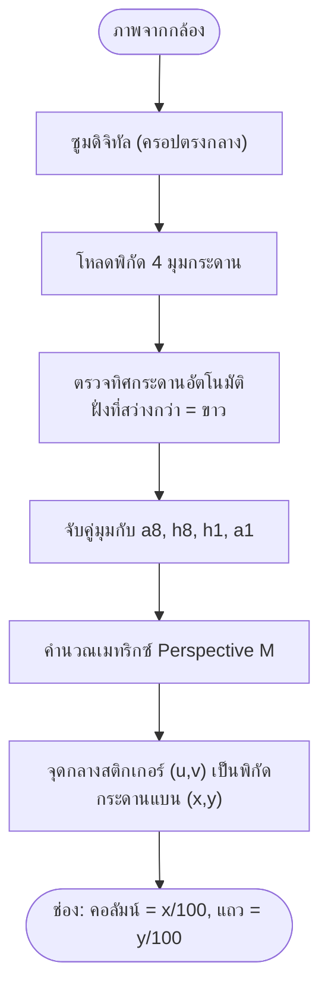
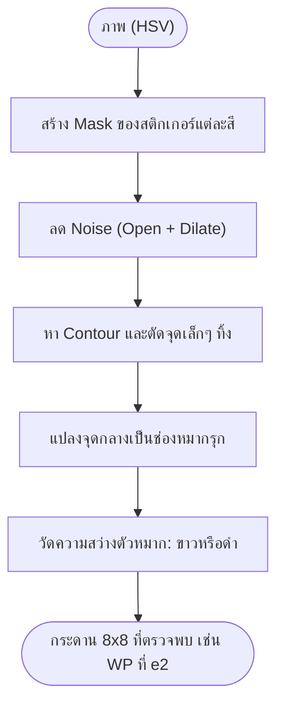
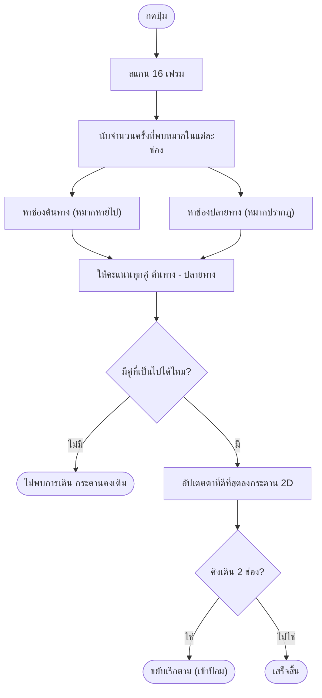
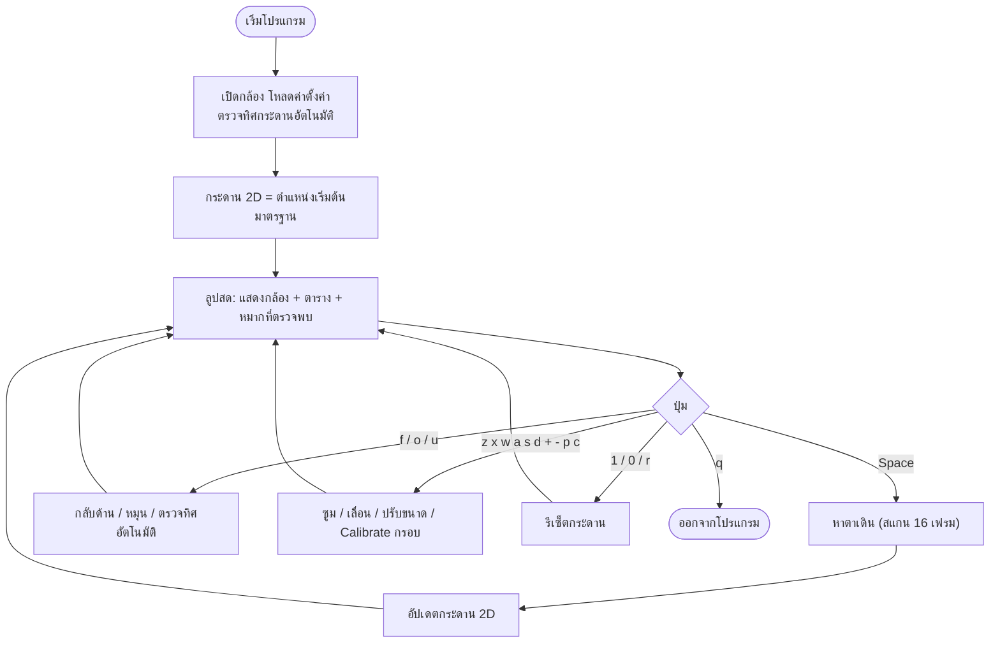
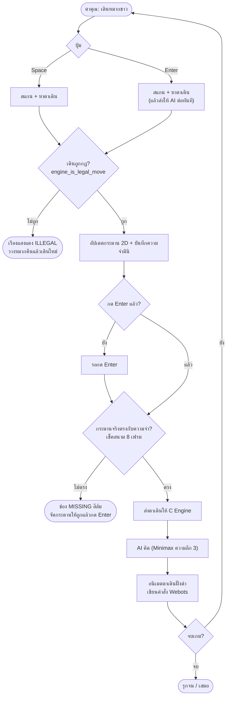
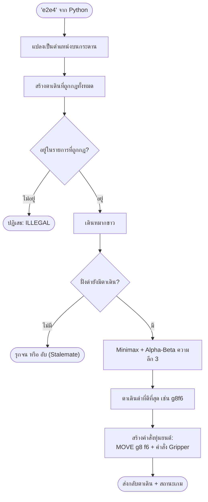

# ♚ ระบบหมากรุก Hybrid Physical-to-Digital Twin

> **ทีม:** GM ลงเซิฟ — รายวิชา Robotics 01306202
> 🇬🇧 [English version](README.md)

## นี่คืออะไร?

ระบบหมากรุกที่เชื่อม **กระดานหมากรุกจริง** เข้ากับ **กระดานดิจิทัล (Digital Twin)** โดยใช้กล้อง iPhone มองจากด้านบนลงมา หมากแต่ละตัวติดสติกเกอร์สีเพื่อบอกชนิดของหมาก ระบบจะแปลงการเดินบนกระดานจริงให้เป็นการเดินบนกระดาน 2D และในโหมด Single Player จะมี **AI ภาษา C** เดินฝั่งดำตอบกลับ แล้วส่งคำสั่งไปยังหุ่นยนต์จำลองใน Webots

| โปรแกรม | หน้าที่ |
| :--- | :--- |
| `chess_live_board.py` | ติดตามการเดินหมากจริงทุกตา (ทั้งขาวและดำ) แล้วแสดงบนกระดาน 2D ไม่มี AI |
| `chess_single_player.py` | คน (ฝั่งขาว เดินบนกระดานจริง) vs. หุ่นยนต์ AI (ฝั่งดำ ใช้ C Engine) ระบบจะเช็คว่าคนเดินถูกกฎหรือไม่ และเช็คว่ากระดานจริงตรงกับความจำหรือไม่ ก่อนให้ AI เดิน |
| `libchess_ai.dylib` (C) | กฎหมากรุก + AI แบบ Minimax (Alpha-Beta, ความลึก 3) ซึ่ง Python เรียกใช้ผ่าน `ctypes` |

---

## ภาพรวมการทำงาน



---

## 1. แปลงพิกัดกระดาน (Pixel ของกล้อง → ช่องหมากรุก)

ระบบนำ 4 มุมของกระดาน (ค่าที่บันทึกไว้ หรือคลิกตอน Calibrate) มาจับคู่กับ `a8, h8, h1, a1` ตามฝั่งที่หมากขาวอยู่ ซึ่งระบบตรวจหาเองอัตโนมัติจากความสว่าง จากนั้นใช้ **Perspective Transform** แปลงภาพกล้องให้เป็นกระดานแบนขนาด 800×800 โดยแต่ละช่องขนาด 100×100 คือ 1 ช่องหมากรุก



## 2. ตรวจจับหมาก

| สีสติกเกอร์ | หมาก |
| :--- | :--- |
| ส้ม | Queen (ควีน) |
| เหลือง | Pawn (เบี้ย) |
| เขียว | Knight (ม้า) |
| น้ำเงิน | Bishop (บิชอป) |
| ม่วง | King (คิง) |
| ชมพูบานเย็น | Rook (เรือ) |

ระบบแยกฝั่งจากความสว่างของตัวหมากใต้สติกเกอร์ (สว่าง = ขาว, มืด = ดำ)



## 3. หาตาเดิน

เมื่อกดปุ่ม กล้องจะสแกน **16 เฟรม** แล้วนับว่าแต่ละช่องตรวจพบหมากกี่ครั้ง จากนั้นเทียบกับกระดานดิจิทัลในความจำ:

- **ช่องต้นทาง:** ช่องที่ควรมีหมาก แต่ตอนนี้แทบตรวจไม่พบ (หมากถูกยกออก)
- **ช่องปลายทาง:** ช่องว่างที่ตอนนี้มีหมาก (หรือช่องของฝ่ายตรงข้ามในกรณีกินหมาก)
- ระบบให้คะแนนแต่ละคู่ต้นทาง-ปลายทาง (ปลายทางว่าง, ชนิดหมากตรงกัน, ฝั่งตรงกัน, ระยะใกล้) แล้วเลือกคู่ที่คะแนนสูงสุด สแกนแต่ละครั้งจะเดิน **ได้แค่ 1 ตาเท่านั้น**
- ถ้าคิงเดิน 2 ช่อง (เข้าป้อม) เรือจะขยับตามอัตโนมัติ



---

## 4. `chess_live_board.py` — ติดตามกระดานสด

แสดงการเดินหมากจริงทุกตา ทั้งฝั่งขาวและดำ ลงบนกระดาน 2D



---

## 5. `chess_single_player.py` — คน vs. หุ่นยนต์ AI

คุณเล่น **ฝั่งขาว** บนกระดานจริง และ **AI เล่นฝั่งดำ** โดย AI จะเดินก็ต่อเมื่อ:
1. คุณ **เดินถูกกฎ** (C Engine เป็นตัวเช็ค) ถ้าผิดกฎ ทั้งสองช่องจะ **เรืองแสงสีแดง** พร้อมคำว่า "ILLEGAL"
2. **กระดานจริงตรงกับความจำ** ถ้าไม่ตรง ช่องที่หมากหายจะ **กระพริบสีส้ม** พร้อมคำว่า "MISSING"



---

## 6. C Engine — AI ตัดสินใจอย่างไร

1. Python ส่งตาเดินเป็นข้อความ เช่น `"e2e4"` แล้ว Engine แปลงเป็นตำแหน่งบนกระดาน
2. Engine **สร้างตาเดินที่ถูกกฎทั้งหมด** โดยลองเดินแต่ละตา ถ้าเดินแล้วคิงของตัวเองโดนรุกจะตัดตานั้นทิ้ง วิธีนี้ครอบคลุมการรุก การถูกตรึง (Pin) และการเข้าป้อม
3. เวลาฝั่งดำตอบ จะใช้ **Minimax + Alpha-Beta Pruning** (ความลึก 3):
   - **คะแนน** = มูลค่าหมาก (P=100, N=320, B=330, R=500, Q=900) + โบนัสตำแหน่งของเบี้ยและม้า คิดเป็นคะแนนขาว − ดำ
   - ฝั่งขาวพยายามให้คะแนนสูงสุด ฝั่งดำ (AI) พยายามให้ต่ำสุด และเลือกรุกจนที่เร็วกว่าก่อน
4. ส่งกลับตาเดินที่ดีที่สุด คำสั่งหุ่นยนต์ และสถานะเกม (เล่นต่อ / รุกจน / เสมอ)



**ผลลัพธ์ที่ส่งให้หุ่นยนต์:** `webots_command.txt` (เช่น `MOVE g8 f6`) และ `webots_move.json` (ตาล่าสุด + คำสั่ง Gripper)

---

## 7. การติดตั้ง

```bash
pip3 install opencv-python numpy pillow
make            # คอมไพล์ libchess_ai.dylib และ robotic_engine
```

คำแนะนำ: วาง iPhone **ตรงเหนือกระดาน** ให้กรอบสีเขียวตรงกับขอบกระดาน และให้ป้าย `WHITE` อยู่ฝั่งเดียวกับหมากขาวจริง

---

## 8. วิธีใช้งาน

### Live Board

```bash
python3 chess_live_board.py 1         # เริ่มจากตำแหน่งมาตรฐาน (แนะนำ)
python3 chess_live_board.py 0         # อ่านตำแหน่งหมากจากกล้อง
python3 chess_live_board.py 1 flip    # กระดานกลับด้าน 180°
python3 chess_live_board.py 1 black   # แสดงกระดาน 2D จากมุมฝั่งดำ
```

1. เดินหมาก 1 ตัว (สีใดก็ได้) แล้วเอามือออกจากกล้อง
2. กด **Space** ตาเดินจะแสดงบนกระดาน 2D

### Single Player

```bash
python3 chess_single_player.py 1
```

1. เดินหมาก **ฝั่งขาว** แล้วเอามือออกจากกล้อง
2. กด **Enter** เพื่อจบตา ระบบจะสแกน → เช็คกฎ → เช็คสนาม → AI เดิน
   (ถ้าอยากพรีวิวและเช็คตาเดินก่อน ให้กด **Space**)
3. ถ้าเรืองแสงแดง แปลว่าเดินผิดกฎ ให้วางหมากคืน ถ้าเป็นสีส้ม แปลว่าหมากหาย ให้จัดกระดานแล้วกด Enter ใหม่
4. ขยับหมากดำบนกระดานจริงตามที่ AI เดิน แล้วเดินตาต่อไปของคุณ

### ปุ่มควบคุม

| ปุ่ม | Live Board | Single Player |
| :---: | :--- | :--- |
| `Space` | สแกนและอัปเดตตาเดิน | สแกนและเช็คตาเดิน (ไม่สั่ง AI) |
| `Enter` | — | จบตา → AI เดิน |
| `1` | รีเซ็ตเป็นตำแหน่งเริ่มต้น | เริ่มเกมใหม่ |
| `r` | ล้างกระดานและสแกนใหม่ | เริ่มเกมใหม่ |
| `0` | สแกนกระดานจากกล้อง | — |
| `t` | สลับตาเดิน | — |
| `f` | กลับด้านกระดาน 180° | กลับด้านกระดาน 180° |
| `F` / `v` | สลับมุมมองกระดาน 2D | — |
| `o` / `u` | หมุน 90° / ตรวจทิศอัตโนมัติ | หมุน 90° / ตรวจทิศอัตโนมัติ |
| `z` / `x` | ซูมเข้า / ออก | ซูมเข้า / ออก |
| `w a s d` | เลื่อนกรอบ | เลื่อนกรอบ |
| `+` / `-` | ขยาย / ย่อกรอบ | ขยาย / ย่อกรอบ |
| `p` | รีเซ็ตกรอบเป็นจัตุรัส | รีเซ็ตกรอบเป็นจัตุรัส |
| `c` | คลิก 4 มุมเพื่อ Calibrate | คลิก 4 มุมเพื่อ Calibrate |
| `q` | ออกจากโปรแกรม | ออกจากโปรแกรม |
